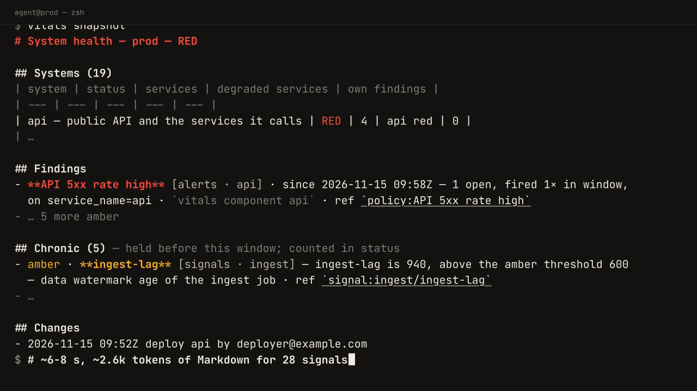

# vitals

[](https://github.com/adriantr/vitals/actions/workflows/ci.yml)
[](https://pkg.go.dev/github.com/adriantr/vitals)
[](LICENSE)

`vitals` is a command-line health check for a whole system on Google Cloud, written for coding
agents first and people second. You describe your system once in a YAML file: the signals that
measure it, the services they attach to and the systems those services form. One `vitals snapshot`
then prints what is wrong, where, since when and what changed, as compact Markdown.

[](docs/assets/demo.mp4)

*Click for the 75-second demo: snapshot, drill into a component, review a past window, check drift.*

The same report as text:

```
# System health — prod — RED
window 2026-11-15 08:00Z → 2026-11-15 14:00Z · 1 red, 1 amber, 0 chronic
sources: signals OK (31 queries) · alerts OK (2 projects) · slo OK (4 services) · errors OK · pubsub OK · delivery OK

## Systems (6)
| system | status | services | degraded services | own findings |
| --- | --- | --- | --- | --- |
| shop — everything a customer needs to buy | RED | 3 | checkout red | 0 |
| fulfilment — order processing after checkout | amber | 1 | order-worker amber | 0 |
| orders-db — Spanner instance holding orders | ok | 0 | — | 0 |

## Services (5)
| service | status | systems | deployed | commit | req/min | 5xx | p95 | inst | findings |
| --- | --- | --- | --- | --- | --- | --- | --- | --- | --- |
| checkout | RED | shop | 2026-11-15 11:52Z | ac7ef12 | 412.0 | 6.1% | 840ms | 7 | 1 red |

## Red (1)
- **cloud-run-5xx** [signals · checkout] — cloud-run-5xx is 6.1%, above the red threshold 5.0% — share of requests answered 5xx · `vitals component checkout` · ref `signal:checkout/cloud-run-5xx`
```

## Why

An agent asked "is production healthy?" usually pieces the answer together from a dozen API calls,
each with its own auth, paging and output format, and spends most of its context window doing it.
`vitals` makes that one call.

- **One call, whole system.** Alerts, SLO burn, new error groups, Pub/Sub backlog, deploy failures,
  Cloud Run traffic and your own PromQL signals, rolled up into one status per service and system.
- **Built for agents.** Markdown tables that fit in a context window, a stable `--json` form, refs
  that feed straight into the next command, exit codes that say whether the picture is complete,
  and a "Blind spots" section instead of silently missing data.
- **Deterministic.** Health comes from the model you declared and live reads. Ownership comes from
  exact names. Nothing is guessed from naming patterns.

## Install

```bash
go install github.com/adriantr/vitals/cmd/vitals@latest
```

Or download a binary for Linux, macOS or Windows from the
[releases page](https://github.com/adriantr/vitals/releases). Each release ships checksums, an SBOM
and build provenance you can check with `gh attestation verify <file> --repo adriantr/vitals`.

## Quick start

```bash
curl -o vitals.yaml https://raw.githubusercontent.com/adriantr/vitals/main/examples/vitals.example.yaml
# edit project ids, services and signals for your estate
gcloud auth login
vitals check       # does the file match what is deployed and alerting?
vitals suggest     # YAML stubs for whatever check found undeclared
vitals snapshot    # the whole system, last 6 hours
vitals component checkout
```

`--config` picks the file; without it vitals reads `$VITALS_CONFIG`, then `./vitals.yaml`.

## The health model

| Piece | What it is |
| --- | --- |
| **signal** | A PromQL query with `amber` and `red` thresholds (or `below: true` for rates that must not drop), evaluated at the end of the window against Cloud Monitoring's PromQL API. `{service}`, `{window}`, `{env}` and `{project}` are filled in; other `{name}`s come from the attachment. |
| **service** | Something that runs. It attaches signals, claims existing alerts, SLO services, Error Reporting services and subscriptions by exact name, lists its OTel `service.name`s, and names what it `dependsOn`. Kind `cloud-run` (the default) also gets its deployed revision, commit and request metrics. |
| **system** | A group of services, with signals and claims of its own: a database, a vendor, a pipeline. |
| **defaults** | Signals every service of a kind gets, such as a 5xx ratio for every Cloud Run service. |

**Worst-of roll-up.** A service is as healthy as its worst signal or finding. A system is as healthy
as its worst service, own signal or own finding. The status order is `ok` < `unknown` < `amber` <
`red`, so a read that failed never shows as healthy. Nothing depends on alert policies existing:
signals alone give a full picture.

**Claims.** Built-in sources add findings and attach each one to an owner. A finding belongs to the
declared service its data names (an alert's `service_name` label, the SLO's service, the Error
Reporting service, a subscription the service pulls). Otherwise it belongs to the service or system
that claims it by exact name in the config. A name claimed twice is a config error, and an unclaimed
finding is listed as unowned.

| Source | Reads | Red | Amber |
| --- | --- | --- | --- |
| `signals` | the declared PromQL | above `red` | above `amber` |
| `deployments` | Cloud Run | a declared service is missing or its latest revision is not ready | |
| `alerts` | Alerts API and alert policies, in every configured alert project | an incident open at the end of the window | a policy fired `flappingFires`+ times in the window and is closed |
| `slo` | burn rate (6h lookback) of the SLOs of declared services | 6h burn ≥ `sloSevereBurn` | 6h burn ≥ `sloSlowBurn` |
| `errors` | Error Reporting group stats | | an error group first seen in the window |
| `pubsub` | DLQ backlog and oldest unacked message per subscription | lag ≥ `pubsubLagRed` | any DLQ backlog, or lag ≥ `pubsubLagAmber` |
| `delivery` | GitHub Actions runs and releases, Cloud Run deploys from the audit log | the latest deploy workflow run failed | one failed and a later run passed |

## Commands

| Command | What it shows |
| --- | --- |
| `vitals snapshot` | Systems and services with their status, then red, amber and chronic findings, deploys and releases, and blind spots. `--slo` adds every SLO's burn rate |
| `vitals component <service>` | One service: declaration, release (revision, commit, latest release), signals, its dependencies' signals, Cloud Run and OTel metrics, findings |
| `vitals explain <ref>` | One finding in depth. Refs look like `policy:<display name>`, `slo:<service>/<slo>`, `error:<group id>`, `pubsub:<subscription>` or `workflow:<file>` |
| `vitals changes` | Deploys and releases in the window |
| `vitals check` | Compares the config with the live estate and exits 1 on drift: undeclared Cloud Run services, declared ones that do not exist, alert policies nobody claims, claims that name nothing, signals that return no data. Run it in CI |
| `vitals suggest` | YAML stubs for whatever `check` finds undeclared |
| `vitals map` | The repository map from the optional `topology:` section. No cloud reads |
| `vitals version` | The version |

Common flags: `--env NAME` (default `defaultEnv`), `--since 30m|6h|2d` (default 6h for `snapshot`
and `component`, 24h otherwise, at most 7d), `--json`, `--config FILE`.

**Exit codes.** `0` every source answered. `1` a source was BLOCKED (missing permission), FAILED or
SKIPPED; for `check` it means drift. `2` bad arguments or config. Progress goes to stderr, the report
to stdout.

### Past windows with `--at`

`--at 2026-11-13T21:00:00Z` ends the window in the past, for incident review. Signals, alerts, SLOs,
Pub/Sub and deploys are read as of that time. Error Reporting cannot answer for a past window, so
the `errors` source reports SKIPPED. The deployed revision on component pages is today's and is
marked as such.

### SLO burn with `--slo`

Without `--slo`, SLOs show up through their burn-rate alert policies. With it, `snapshot` reads the
6h burn rate of every SLO of every declared service. That is one slow Monitoring query per SLO, so
it adds seconds to tens of seconds.

### Chronic findings

An alert whose oldest open incident opened more than `chronicAlertAge` (default 24h) before the
window end is chronic. So is a breached signal that also breaches at the window end on each of the
last `chronicSignalDays` days (default 2, 0 turns it off). Chronic findings count in every status,
but the snapshot lists them in their own **Chronic** section below Red and Amber, and `--json` marks
them `chronic: true`. A fresh incident therefore stands out from the things that have been broken
all week. Only breached queries run again, so the check costs `chronicSignalDays` × the distinct
breached queries.

## Credentials and IAM

| API | Credential |
| --- | --- |
| Google Cloud | Application Default Credentials when `GOOGLE_APPLICATION_CREDENTIALS` is set, else the `gcloud` CLI's login, else ADC (metadata server) |
| GitHub | `GITHUB_TOKEN` or `GH_TOKEN`, else the `gh` CLI's login |

Google Cloud roles on the environment's project: `roles/monitoring.viewer`,
`roles/errorreporting.viewer`, `roles/logging.viewer` and `roles/run.viewer`. On every other alert
project: `roles/monitoring.viewer`. GitHub: read access to contents, Actions and releases. GitHub is
optional; leave out `github:` and the delivery source only reads Cloud Run deploys.

A missing grant shows up as a BLOCKED source under Blind spots, with the API that refused.

## Repository map (optional)

`topology:` reads Terraform locals, Knative/Cloud Run service manifests, a release manifest and JSON
catalogues from your repository. Component pages then show where each fact came from (manifest,
hosts, data stores, topics, callers, sidecars), and `check` and `suggest` can find services your
deploy config ships but the YAML does not declare. Terraform locals are evaluated without Terraform;
what cannot be resolved stays as source text. Health never depends on it. See
[docs/configuration.md](docs/configuration.md#topology).

## Limitations

- **Google Cloud and GitHub only.** Signals are PromQL against Cloud Monitoring, deploys come from
  Cloud Run and GitHub Actions. Other clouds and CI systems would need new sources.
- **Error Reporting cannot replay.** It has no "as of" query, so `--at` skips it.
- **Monitoring API quota.** Cloud Monitoring has a per-user read quota. A snapshot makes one query
  per signal attachment (fewer with `by:`) plus a few dozen more. A second run in the same minute may
  back off. Reuse a report instead of re-running it.
- **Cloud Run is the only service kind with built-in metrics.** Other kinds are declared and get
  their signals and claims, but no revision or request metrics.

## Documentation

- [AGENTS.md](AGENTS.md): how an agent should use vitals, and how to contribute as one
- [docs/configuration.md](docs/configuration.md): every YAML key
- [docs/writing-signals.md](docs/writing-signals.md): PromQL for Cloud Monitoring, with examples
- [docs/architecture.md](docs/architecture.md): how the code fits together
- [docs/agent-skill/SKILL.md](docs/agent-skill/SKILL.md): a skill to drop into your agent setup
- [CONTRIBUTING.md](CONTRIBUTING.md), [SECURITY.md](SECURITY.md), [CHANGELOG.md](CHANGELOG.md)

## License

[Apache License 2.0](LICENSE).
